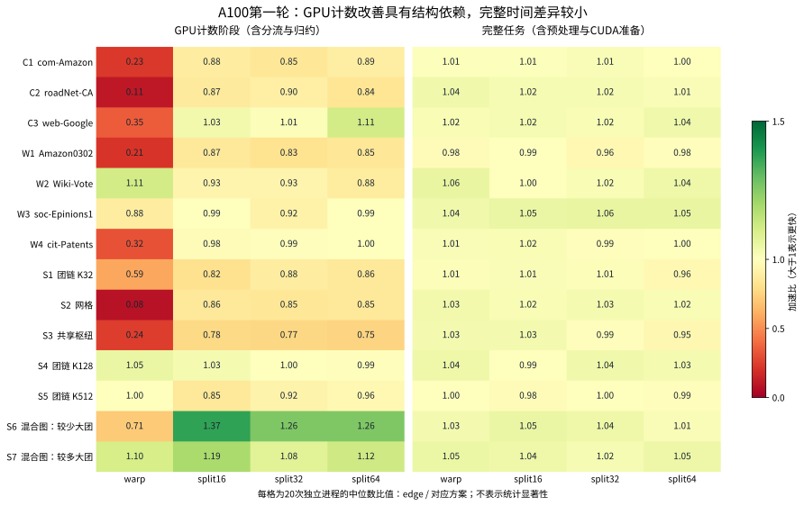

# A100 第一轮：固定 warp 与轻重分流的结果

2026-11-12运行，2026-11-13归档分析。14图×5配置×20次独立进程，共1400次，全部CPU参考核验通过。统一12线程OpenMP预处理，固定warp/split不预设优于边并行baseline。

| 图 | baseline GPU/ms | warp/ms | split16/ms | split16 GPU加速比 |
|---|---:|---:|---:|---:|
| roadNet-CA | 0.1173 | 1.0752 | 0.1349 | 0.87× |
| S2 网格 | 0.0963 | 1.1577 | 0.1118 | 0.86× |
| S5 大团链 | 22.7226 | 22.6665 | 26.6398 | 0.85× |
| S6 混合图 | 0.8289 | 1.1653 | 0.6048 | 1.37× |
| S7 混合图 | 3.5839 | 3.2515 | 3.0122 | 1.19× |

GPU时间包含分流和归约，是首次执行时间的20次中位数。完整14图表、min/max和探索性区间见[完整报告](../results/a100_v1/summary/analysis.md)，[原始数据与复算](../results/a100_v1/README.md)。

## 已有证据支持什么

- 固定warp在14图中的10图GPU阶段更慢，不能简单给每条边32线程。
- 分流在S6/S7显示收益，但S5长任务图仍退化；不能只凭短表长度推断协作一定有效。
- GPU计数本身已快，280个baseline样本中CUDA准备时间整体中位数约295.74ms。完整任务差异通常小，不把预处理/初始化波动归功于计数优化。
- 对无重边图，队列版本依旧有额外路径成本；本轮没有GPU分项插桩，尚不能定量认定队列是唯一瓶颈。
- Wiki-Vote默认启动网格不同，需要追加相同blocks的控制实验。

## 下一步研究

当前实现不变，先探索[warp内虚拟查询池](query_parallel_exploration.md)：保持短表查询集合，通过批内前缀索引将查询分给线程，避免全局重边队列。已有204图/816配置的CPU映射验证；CUDA同步、尾部mask、性能仍待实现和实测。

不预先宣称新方法优于baseline。先验证短任务退化与混合图收益，再考虑摊薄定位、局部选择或全局前缀。历史A800的完整预处理加速单列，见[历史结果](experiment_results.md)。
